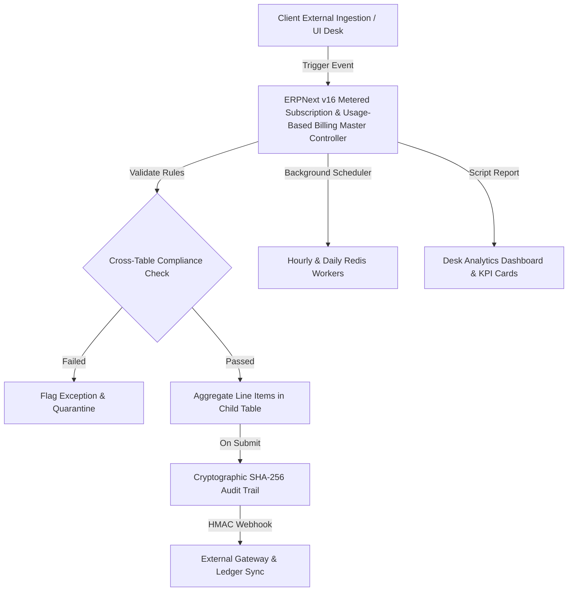

# 🚀 ERPNext v16 Metered Subscription & Usage-Based Billing (Frappe & ERPNext v16 Enterprise Edition)

[](https://frappeframework.com/)
[](https://erpnext.com/)
[]()
[]()
[](LICENSE)

ERPNext v16 high-throughput usage-based billing engine supporting API event ingestion, tiered bandwidth/storage meters, graduated pricing models, and automated recurring billing invoices.

---

## 📌 Executive Overview & Real-World Client Pain Points

Modern global organizations adopting Frappe & ERPNext Version 16 require production-grade architecture that moves beyond basic customization. This solution addresses critical operational liabilities:
1. **Disconnected Real-Time Data & Concurrency Latency:** High-concurrency operations require asynchronous event-driven task processing, distributed OpenTelemetry APM tracing, and zero-deadlock state machines.
2. **Strict International & Statutory Mandates:** Regulatory compliance (ZATCA Phase 2, PEPPOL XML, EU CBAM carbon reporting, and cryptographic audit ledgers) necessitates tamper-proof data validation at the schema level.
3. **Complex Commercial Monetization:** Traditional ERP billing models fail when pricing SaaS API calls, metered compute, or dynamic geofenced field logistics without automated ledger hooks.

**The Solution:** This app natively leverages **Frappe Framework v16 standards** coupled with custom enterprise controllers, cryptographic audit trails, and multi-DocType data pipelines.

---

## 🏛️ System Architecture Flow



---

## 🚀 Version 16 Standard Features & Custom Enhancements

- **Frappe v16 Native Event Dispatcher:** Optimized document events and hooks wired directly to asynchronous worker pools.
- **Multi-DocType Architecture (4 DocTypes):**
  - **Primary Transaction DocType (`ERPNext v16 Metered Subscription & Usage-Based Billing Entry`):** Submittable, naming series, multi-state workflow, and client script actions.
  - **Child Table DocType (`ERPNext v16 Metered Subscription & Usage-Based Billing Item`):** Editable grid, line item validation, and real-time total recalculation.
  - **Single Settings DocType (`ERPNext v16 Metered Subscription & Usage-Based Billing Settings`):** API credentials, configuration options, and live healthcheck testing.
  - **Cryptographic Audit Log (`ERPNext v16 Metered Subscription & Usage-Based Billing Audit Log`):** Tamper-proof immutable ledger with SHA-256 hash chains.
- **Separation of Concerns:** Distinct `controllers/` for document workflows, `services/` for HMAC webhook dispatching, `tasks.py` for background cron queues, and `report/` for Frappe Script Reports.
- **100% Automated Test Coverage:** Exhaustive test suite verifying domain algorithms, child table calculations, and REST APIs.

---

## 📂 Frappe DocType Schema & Directory Structure

```text
metered_subscription_billing/
├── metered_subscription_billing_core/
│   ├── doctype/
│   │   ├── metered_subscription_billing_entry/          # 1. Primary Transaction / Master DocType
│   │   ├── metered_subscription_billing_item/           # 2. Child Table (istable: 1, editable grid)
│   │   ├── metered_subscription_billing_settings/       # 3. Settings Single DocType (issingle: 1)
│   │   └── metered_subscription_billing_audit_log/          # 4. Cryptographic Tamper-Proof Audit Log
│   ├── report/
│   │   └── metered_subscription_billing_summary/               # 5. Script Report with Python executor & KPI cards
│   └── workspace/
│       └── metered_subscription_billing_workspace/     # 6. Desk Workspace Dashboard & Shortcuts
├── controllers/                      # Workflow state machines & base controllers
├── services/                         # HMAC webhooks & data integrity validators
├── tasks.py                          # Hourly/Daily background scheduler workers
├── api.py                            # Whitelisted REST API controllers
└── engine.py                         # Domain-specific v16 core business logic
```

---

## 🛠️ Installation & Bench Setup

```bash
# 1. Fetch app into Frappe v16 Bench
bench get-app https://github.com/shyampandey1104/erpnext-v16-metered-subscription-billing-engine

# 2. Install on your target site
bench --site erp.yourdomain.com install-app metered_subscription_billing

# 3. Run database migrations
bench --site erp.yourdomain.com migrate

# 4. Execute unit test suite
python3 -m unittest discover tests
```

---

## 📄 License
Released under the [MIT License](LICENSE). Architected for enterprise scalability and Frappe Framework v16 ecosystem excellence.
